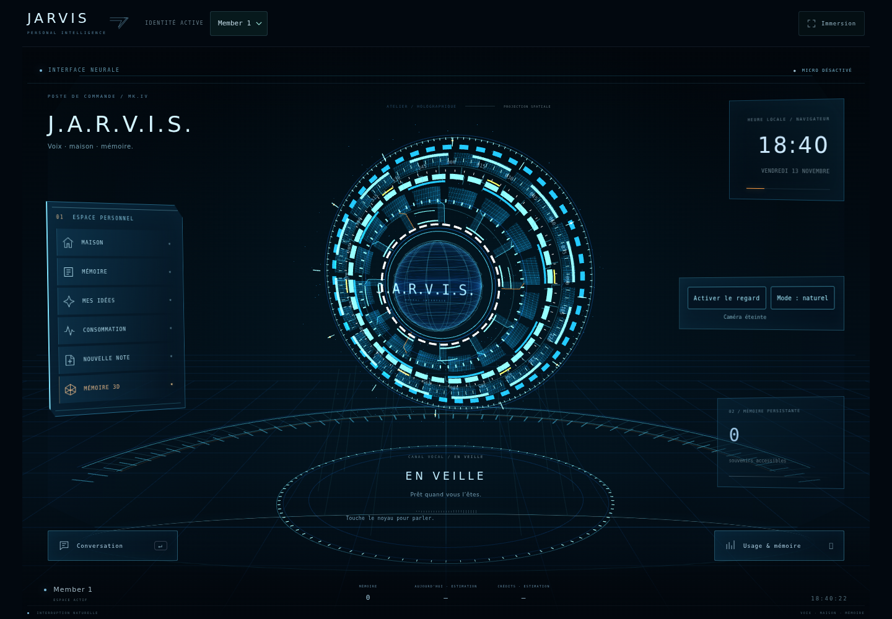
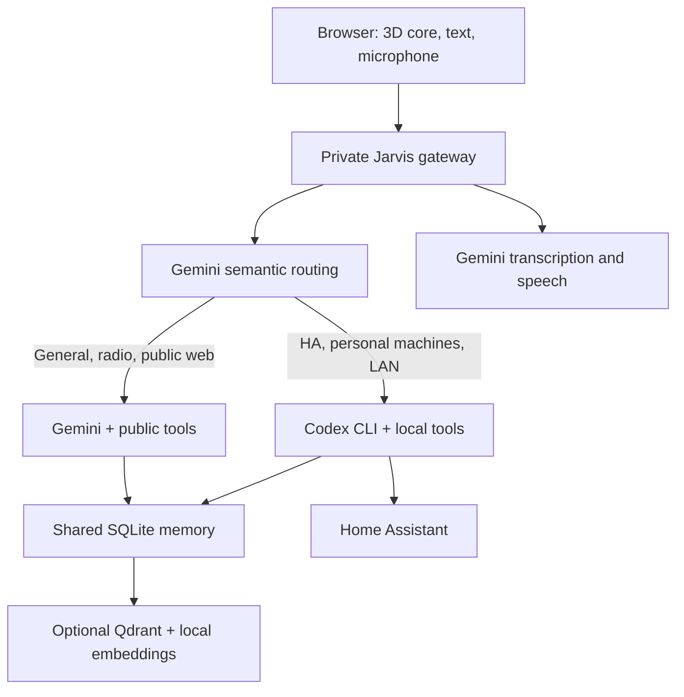

# Jarvis — Holographic Home Assistant

A personal assistant with a living 3D holographic core, natural voice conversations, persistent memory and real tools for your home.

**Gemini handles everyday requests. Codex handles your home and machines.** The written and spoken interfaces share the same routing, history and memory.

This repository is a standalone, sanitized release of a working personal deployment. It starts with empty memory and generic profiles. It contains no personal conversations, API keys, cloud credentials, host certificates or original deployment history.



## Features

- GPU-rendered holographic core with transparent segmented instruments, a scanned energy sphere, projected J.A.R.V.I.S. lettering, particles and real audio-reactive movement.
- Content screens appear only when requested: play YouTube directly in a miniature screen, enlarge or minimize the same attached player, and open validated external links in a new tab. Closing a window or dismissing its screen stops its media. Phone screens form a compact horizontal strip.
- A panoramic desktop workspace with suspended glass screens, a curved console and spatial grid, without characters or simulated telemetry.
- Safari iPhone and desktop layouts, adaptive rendering quality and a non-WebGL fallback.
- Optional local face tracking: move the core with your face and change its apparent size by moving closer or farther away.
- Text chat and Gemini transcription/speech; natural interruption and uninterrupted dictation modes.
- Click the core to start, then click again to mute/unmute only the microphone. A separate **End voice conversation** control stops the session without deleting messages.
- Semantic routing: public/general requests go directly to Gemini; HA, LAN, personal machines and Jarvis code changes go to Codex.
- Home Assistant state queries and explicitly requested device commands, with entity/service checks.
- Radio discovery by name or genre, YouTube, public web search, directory lookups and content-specific popups.
- Maps and traffic routes through optional Google integrations.
- SQLite conversation archives, explicit facts, grounded user corrections and optional Qdrant semantic retrieval/3D memory exploration.
- Google usage estimates and optional official Cloud Billing export data; separate Codex account usage display.
- Codex-assisted development, including isolated evolution drafts. Generated code still needs testing and review.

The default interface and assistant language are **French**. These installation and operating instructions are in English. This release does not claim a complete English UI translation.

## Architecture



Classification is model-based and can be wrong. Before public tool batches execute, a second check detects local actions and hands the original request to Codex. A Google failure does not silently send a general request to Codex.

## Requirements

- **Node.js 22.6+**, npm, **Python 3.10+**, Git.
- Linux is the recommended server platform. The portable release is tested on Linux; macOS is not fully validated.
- A Gemini API key with access to the configured text, transcription and speech models.
- An installed, signed-in Codex CLI for local/HA tasks.
- Home Assistant, Docker/Qdrant, Maps, YouTube and Cloud Billing are optional integrations.
- No RTX, graphics server or server-side GPU is required. The browser renders the core; optional embeddings run on CPU.

## Step 1 — Clone and install

```bash
git clone https://github.com/jeanne0r/jarvis-holographic-assistant.git
cd jarvis-holographic-assistant
node --version
python3 --version
npm ci
npm run setup
```

Setup creates ignored `data/`, `memory/` and `.env` files. It does not import existing conversations or overwrite an existing configuration.

## Step 2 — Connect Codex

Install and authenticate using the [official Codex CLI instructions](https://learn.chatgpt.com/docs/codex/cli). Follow the [authentication documentation](https://learn.chatgpt.com/docs/auth) for ChatGPT sign-in or API-key authentication.

```bash
npm install -g @openai/codex
codex login
codex --version
```

Run these as the same OS user that will run Jarvis. Do not copy your Codex `auth.json` into this repository. If Codex is outside PATH, set `CODEX_BIN` in `.env`.

## Step 3 — Configure Gemini and models

Open `.env` in your editor and fill in:

```dotenv
GEMINI_API_KEY=your-own-server-side-key
JARVIS_ENGINE=hybrid
```

The example lists the model IDs used by the source deployment. **Model names, API availability and pricing vary over time and by account.** Check the [Google model catalog](https://ai.google.dev/gemini-api/docs/models) and set these variables to models your account can use:

| Variable | Purpose |
| --- | --- |
| `JARVIS_GEMINI_TEXT_MODEL` | Routing and general reasoning; structured JSON/tool loop |
| `JARVIS_GEMINI_TRANSCRIBE_MODEL` | Speech transcription through the Google Interactions API |
| `JARVIS_GEMINI_TTS_MODEL` | Streaming PCM speech through the Google Interactions API |
| `JARVIS_CORE_MODEL` | Codex model used for local tasks |
| `JARVIS_CORE_REASONING` | Codex reasoning effort; default `low` |

Changing a model name alone cannot make an incompatible API work. The speech adapter expects Interactions transcription and streamed audio support. A model supporting only another API requires an adapter change. See [configuration](docs/CONFIGURATION.md).

Protect your local configuration:

```bash
chmod 600 .env
npm run doctor
```

Doctor checks configuration presence and executables, not provider account access or model compatibility. It does not print credentials.

## Step 4 — Start locally

```bash
npm start
```

Open [Jarvis on localhost](http://127.0.0.1:8787/jarvis/). Try a written request first. Without provider credentials, the interface and local memory still load, but AI requests cannot complete.

The server binds to `127.0.0.1` by default. Do not forward its port to the public Internet.

## Step 5 — Enable HTTPS for iPhone / LAN access

A phone is a different machine: its `localhost` is not your server. Microphone and camera access require a secure context. Merely replacing `http` with `https` does not create a TLS listener.

1. Give the server a stable LAN hostname/address.
2. Obtain a certificate trusted by the clients. A local CA tool such as [mkcert](https://github.com/FiloSottile/mkcert) can create LAN certificates; follow its platform instructions and install/trust its CA on your iPhone. Keep the CA private key private.
3. Store the server certificate and private key outside Git, for example in ignored `data/certs/`.
4. Set your own values in `.env`:

```dotenv
HOST=0.0.0.0
PORT=8788
JARVIS_ACCESS_PASSWORD=choose-a-long-random-password
HTTPS_KEY=data/certs/jarvis-key.pem
HTTPS_CERT=data/certs/jarvis.pem
```

5. Restart Jarvis and open `https://YOUR-LAN-HOST:8788/jarvis/` on the phone.
6. Sign in to the browser's authentication prompt with username **jarvis** and your configured password. Allow microphone access when asked.

Non-loopback mode refuses to start without both a password and HTTPS. Use LAN or a private VPN such as Tailscale. This app can execute local agent tools; it is not intended as an anonymous public service. See [security](SECURITY.md).

## Step 6 — Connect Home Assistant (optional)

1. In your HA user profile, create a long-lived access token for the account Jarvis will use.
2. Set `HOME_ASSISTANT_URL` and `HOME_ASSISTANT_TOKEN` in `.env`.
3. Restart Jarvis.
4. Ask for a read first, such as “Quelle est la température du salon ?”. Verify the answer against HA.
5. Try an explicit command on a noncritical device. Jarvis must resolve actual entities and available services first.

Use an HA account with only the access you intend to grant. A real-time reading comes from HA, never from an old memory. Generic questions explaining HA can remain on Gemini.

Examples: “Mets une radio jazz ici” uses Gemini/browser playback; “Mets une radio jazz sur le HomePod du salon” uses Codex/HA. Playback support depends on the device integration. Safari may require one tap to permit media sound.

## Step 7 — Enable semantic memory (optional)

SQLite works without Qdrant. To add semantic search and the 3D memory view:

1. Install Docker Engine and Compose.
2. Generate a separate random key:

```bash
openssl rand -hex 32
```

3. Put that value in `.env` as `QDRANT__SERVICE__API_KEY`. Keep the default loopback URLs.
4. Start the optional services:

```bash
docker compose up -d --build
docker compose logs --tail=30 embeddings
```

5. The first embedding startup downloads a multilingual model and can take several minutes. Then index your own local memories:

```bash
npm run memory:index
```

Qdrant and the embedding service bind to loopback host ports only. Their keys, model cache, vector store and SQLite databases are not published. Schedule the index command if you want regular background updates. See [memory operations](docs/OPERATIONS.md).

## Step 8 — Optional integrations and usage

- **Google Maps:** set `GOOGLE_MAPS_BROWSER_KEY`, enable the APIs needed by your maps/route usage, and restrict the browser key to your actual Jarvis origin and APIs. This designated key is intentionally visible to the browser.
- **YouTube:** set a server-side `YOUTUBE_API_KEY` for search. Without it, Jarvis can open a YouTube search instead of inventing a video ID.
- **Other gateway apps:** add your own links in ignored `data/app-links.json`; see [configuration](docs/CONFIGURATION.md). The original household's separate apps are not included.
- **Usage:** open **Usage & mémoire**. Google estimates and Codex quotas are separate. Cloud Billing export setup is described in [billing](docs/BILLING.md); official billing can lag. The prepaid wallet is not synchronized through an undocumented API.

## Everyday use

1. Click the core to open the microphone.
2. Speak, then leave a short pause.
3. In **natural** mode you can interrupt by speaking; in **dictation** mode capture pauses while Jarvis processes and speaks.
4. Click the core again to mute only your microphone. Jarvis finishes its current answer. Click again to resume.
5. Click **Terminer la conversation vocale** to end the voice session. Messages stay in the conversation.
6. **Nouvelle conversation** clears the current thread; it does not erase durable memories.
7. Text entry: **Enter** sends; **Alt+Enter** inserts a newline.
8. Camera/face tracking is optional and processed locally. It does not send camera frames to Gemini.

Profiles are generic `member1`–`member4` and `shared`. They are memory compartments, **not separate authenticated accounts**. Do not use these profiles as a privacy boundary between untrusted users.

## Tests and development

```bash
npm test
npx playwright install chromium
npm start
# in another terminal:
npm run test:browser
```

Unit/integration tests use simulated providers and isolated SQLite data. Browser speech tests use a test clock and mocked Google audio; they do not prove acoustic behavior on a physical iPhone. See [validation notes](docs/VALIDATION.md) for exactly what was exercised.

A GitHub Actions template is included at [examples/github-actions.yml](examples/github-actions.yml). To activate CI, copy it to `.github/workflows/ci.yml` and push with a GitHub credential allowed to modify workflows. It is a template, not an enabled workflow in this initial release.

Before publishing your own fork:

```bash
git add .
npm run scan:public
```

The scanner is a supplemental check, not a guarantee that all sensitive content has been found. Always inspect staged files and history.

## License

MIT for project code; see [LICENSE](LICENSE) and [third-party notices](THIRD_PARTY_NOTICES.md). This project is independent of the film franchise and of its AI providers.
