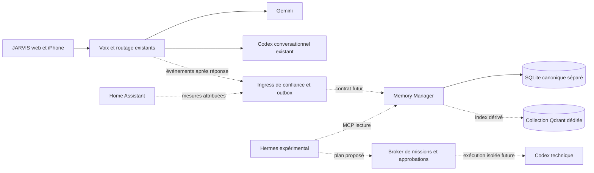

# JARVIS 2 — Architecture et périmètre réalisé

La phase 2 conserve cette architecture et fournit maintenant les adaptateurs
dans `memory_manager/phase2/` : API de missions, outbox/worker séparés, approbations,
MCP étendu, inférence locale, pipeline raisonné, budgets et registre de compétences.
La RTX réelle est sur Windows Gamer (10 Go), Ollama installé mais arrêté.
Hermes officiel possède une API /v1/runs, désormais vérifiée et épinglée.
Les raccordements de production du diagramme restent désactivés : les nouveaux
tests utilisent des endpoints simulés et une sandbox OS réelle pour fixtures.
Voir [rapport de phase 2](JARVIS_2_PHASE2_REPORT.md) et [audit GPU](JARVIS_2_PHASE2_GPU.md).

## Décision principale

Conserver JARVIS et son routage hybride. Ajouter un Memory Manager indépendant
du fournisseur IA et un registre de missions hors du processus vocal.
Le prototype est dans `memory_manager/`, Python 3.12 + bibliothèque standard,
sans nouvelle dépendance. C’est cohérent avec le stockage Python/SQLite existant
et évite de demander une montée de version Node pour amorcer la mémoire.

Les traits pointillés représentent les raccordements futurs. Aucun module
du prototype n’est importé par la gateway ; aucun abonnement HA ni scheduler
de production n’a été ajouté.

## Responsabilités et vérité

- SQLite conserve événements sources, connaissances structurées, versions,
  relations, checkpoints et journaux ; Qdrant ne décide jamais de la vérité.
- L’ingress serveur distingue message utilisateur original, mesure HA, test,
  inférence IA et document externe. La classification d’une source ne vient
  jamais du modèle qui propose le fait.
- La mémoire distingue identité, connaissance, épisode, projet, compétence,
  leçon. Une expérience similaire est retournée comme `analogy_only`.
- Une correction autorisée ajoute une révision au même identifiant stable,
  avec contrôle de concurrence `expected_revision`. La révision précédente
  reste lisible. Un retour arrière ajoute une révision compensatrice.
- La vérification exige un rôle serveur distinct et une source mesure/test
  avec preuve. Le prototype contrôle cette chaîne d’autorité ; il ne certifie
  pas lui-même la véracité physique d’un capteur ni l’authenticité d’une URL.
  Le futur ingress doit vérifier/capturer la preuve avant de fournir ce rôle.

## Contrats de données et recherche

Voir `JARVIS_2_MEMORY_SCHEMA.md`. La requête combine FTS5, filtres de type/sujet,
validité actuelle et résultats vectoriels optionnels. Les hits vectoriels
apportent seulement des identifiants/révisions : contenu, ACL, validité et
provenance sont relus depuis SQLite. Une ancienne révision ne peut revenir
par l’index. Les faits validés sont prioritaires ; une contradiction entre
deux connaissances acceptées sur le même sujet/prédicat est signalée sans
résolution automatique. Une proposition externe reste inferred et ne dégrade
pas le statut d’un fait validé.

L’indexeur expérimental reçoit deux dépendances injectées, transport Qdrant
et fonction d’embedding. Il refuse toute collection hors du préfixe
`jarvis_knowledge_experimental_`, vérifie 384 dimensions et les valeurs finies,
fait des upserts à identifiants déterministes et ne supprime aucun point.
Les tests utilisent un faux transport et des vecteurs synthétiques. Le pont
d’embeddings actuel n’expose pas d’endpoint d’embedding brut indépendant de
sa collection : un raccordement réel demande une extension contrôlée ou un
service local séparé. Aucun faux vecteur n’a été envoyé au vrai Qdrant.

## Consolidations

| Cadence | Réalisé en laboratoire | Étape suivante |
|---|---|---|
| Immédiate | Événement structuré, candidates bornées, source, transaction, clé d’idempotence, correction explicite | Outbox après archivage JARVIS ; extraction de texte vers propositions seulement |
| Nocturne | Snapshot de révisions, détection de doublons exacts et contradictions, propositions avec checkpoint transactionnel | Similarité d’épisodes, état projet et obsolescence, relecture des révisions avant application |
| Hebdomadaire | Propositions de compétences et statistiques de succès/échec depuis outcomes structurés | Évaluations métier, déclassification proposée, validation humaine |

`enqueue`, `tick` et `control` rendent le traitement pilotable et reprenable.
Une interruption avant commit ne conserve ni résultat partiel ni curseur.
Les suggestions n’altèrent aucun fait. L’indexation est une opération séparée.
Budgets du prototype : zéro token, zéro coût API, 1 à 5 échecs maximum,
1 à 100 éléments par tick et tranche coopérative de 30 s maximum ; snapshot
borné à 10 000 entrées. Le temps de lecture du snapshot et d’un élément n’est
pas une limite murale stricte : prévoir aussi timeout système et mémoire/CPU
par cgroup avant une charge réelle. Aucun ordonnanceur n’est installé.

## Missions et exécution technique

Le registre SQLite matérialise les neuf états demandés, la définition complète
d’une mission et son journal. Les transitions ont un état attendu et les
terminaisons completed exigent une preuve. L’état survit à une réouverture.
Le prototype n’exécute aucune commande. Une mission en attente d’approbation
ne peut pas se réautoriser, même en passant par paused. Le broker humain
est désormais fourni en phase 2 séparée ; cette transition historique reste
fermée dans le registre de phase 1 et ne peut contourner le nouveau broker.

Architecture d’exécution proposée : processus/compte par mission, checkout
jetable, dépôt de compétences publié en lecture seule, HOME isolé, aucune
base réelle montée, réseau refusé par défaut, sorties bornées. Un broker hors
du worker applique outils autorisés, budget global incluant sous-agents et
approbations liées à l’empreinte exacte d’une action. Les résultats inconnus
d’une commande externe ne sont jamais rejoués automatiquement.

La demande vocale crée une mission via HTTP 202 puis reprend immédiatement
la conversation. Un canal d’événements séparé informe de sa progression ;
aucune boucle de mission dans la requête STT/TTS ou dans le renderer audio.

## Proactivité proposée

Un ingress par source normalise `event_id`, `source`, `observed_at`, `subject`,
`severity`, `dedupe_key`. Les règles déterministes filtrent d’abord seuils,
fenêtres temporelles, répétitions et événements déjà traités. Une contrainte
unique source+event_id évite les doubles missions. Fenêtre anti-rebond et
quota par sujet empêchent les notifications répétées ; priorité critique
séparée, résumé périodique pour le reste. Une IA n’intervient qu’après ce filtre
et réservation atomique d’un budget approuvé. Événements prévus : HA en lecture,
cron, tests, GitHub, missions, évolution de projet et anomalies.

Une mémoire, une compétence et une notification ne sont jamais une autorisation
de commander chauffage, électricité ou pompe. Le contrôleur physique et ses
interverrouillages restent indépendants du modèle.

## Décisions avant raccordement

1. Approbation d’un déploiement de préproduction isolé, identité serveur et
   mapping explicite des espaces existants vers les ACL.
2. Politique d’import : commencer par un export en lecture seule ; tous les
   textes historiques restent des sources, sans promotion automatique.
3. Collection dédiée et extension d’embeddings en CT205 après sauvegardes ;
   aucune réutilisation du `/prune` global existant.
4. Installation éventuelle d’Hermes épinglé, outils actifs, fournisseur et budget
   API. Budget par défaut maintenu à zéro en attendant cette décision.
5. Politique de publication de compétences et identité distincte de l’approbateur.

Ces décisions ne bloquent ni les documents ni le développement local réalisé.

## Résultat phase 3 observé le 14 novembre 2026

Un premier cycle Hermes officiel + Qwen4B sur RTX3080 + mémoire canonique a
réussi en laboratoire. Le runtime épinglé exige 64000 tokens ; le profil
préparatoire8192 n’est pas compatible. Sources, mesures, limites et procédure
de reprise sont dans [JARVIS_2_PHASE3_REPORT.md](JARVIS_2_PHASE3_REPORT.md).
La VM102 est arrêtée et les allocations des invités existants sont restaurées.
La mission compétence est inachevée, Qdrant réel et gateway restent différés.
