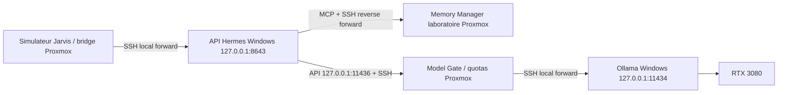

# JARVIS 2.0 — phase4 : Hermes natif sur Windows

État au 14 novembre 2026 : **provisionnement A et pilote B réalisés après accord**.
Les trois missions natives Windows réussissent, dont création, évaluation et
retrouvaille d'une compétence candidate après redémarrage d'Hermes. Aucun
raccordement production ou lancement permanent. Le [rapport réel](JARVIS_2_PHASE4_REPORT.md)
et les [preuves Windows](JARVIS_2_PHASE4_WINDOWS_VALIDATION_REAL.json) précisent
les commandes, mesures, limites et erreurs initiales. Les sections de préparation
ci-dessous décrivent le plan d'origine ; l'état réel du rapport prévaut.
La stratégie de réservation RAM Proxmox est abandonnée ; VM102 reste arrêtée.

## 1. Conclusion de faisabilité et observations réelles

**Windows natif est pris en charge dans le commit déjà épinglé**
`4959268e312a21a361f248e49030d5f5df3984d5` ; aucun changement de version n'est
nécessaire à ce stade. Cette compatibilité a depuis été exercée par les trois missions synthétiques
natives documentées dans le rapport. Ni WSL ni Docker ne sont requis
pour les fonctionnalités du pilote. Les interfaces finales devront être exercées.

| Élément observé | Résultat / limite |
|---|---|
| PC | GAMER, Windows11 Professionnel64bits, version10.0.26300, build26300 |
| RAM | 31,94Gio physiques, 23,11Gio disponibles lors de l'audit |
| CPU | 20 processeurs logiques |
| Stockage | C:182,41Gio libres ; F:55,46Gio libres |
| RTX | RTX3080, 10240Mio, pilote621.24 ; 1063Mio utilisés, 9177Mio libres, charge0% au relevé |
| Kryptex | Installation et interface présentes, aucun mineur détecté à cet instant ; disponibilité à revérifier avant chaque essai |
| Ollama | Client0.35.1 présent ; aucun serveur joignable/port11434 en écoute, donc pas opérationnel maintenant |
| Modèle4B | qwen3.5:4b, blobs présents, 3324173934octets ; digest identique au pilote validé |
| Autre modèle | Ancien9B conservé, blobs présents ; aucun nouveau modèle téléchargé |
| Python | Python3.10.11 réellement exécuté en mode isolé ; inadéquat pour le jeu de dépendances retenu |
| Git / uv / Hermes | Non trouvés dans PATH ni les emplacements ciblés ; ce n'est pas un inventaire exhaustif du disque |
| SSH | OpenSSH9.5p2, sshd Running, accès existant vérifié avec clé d'hôte connue |
| Identité actuelle | Compte SSH administrateur : réservé au provisionnement, interdit pour le runtime |
| Identité cible | hermeslab absent ; création et vérification nécessaires après accord |

Le client Ollama et les manifests ne prouvent ni chargement GPU actuel ni API
active. Le digest des manifests et la présence des blobs sont vérifiés ; le
contrôle réel `/api/tags` et la résidence `/api/ps` restent à faire après accord.

Proxmox : configurations103/201 identiques, SHA256, au retour arrière vérifié dans
f92fa15 ; aucun gardien phase3 chargé. VM102 jarvis-lab reste **arrêtée**,4Gio,
balloon0, onboot0, disque24Gio sur HDD préservé. Rien n'a été redimensionné.
Les travaux RAM interrompus sont archivés, pas supprimés :
[JARVIS_2_PHASE3_RAM_SIZING_ARCHIVE.md](JARVIS_2_PHASE3_RAM_SIZING_ARCHIVE.md).

Preuves : WINDOWS_AUDIT_REAL.json, WINDOWS_DEPENDENCIES_REAL.json,
WINDOWS_SYNTAX_FINAL_REAL.json, PROXMOX_READONLY_REAL.json, préfixés JARVIS_2_PHASE4_.

## 2. Capacités vérifiées dans le code épinglé

| Besoin | Sources observées | Portée de la conclusion |
|---|---|---|
| API de missions | gateway/platforms/api_server.py, api_server_runs.py | POST/v1/runs, GET état/events, POST approval/stop ; client HermesRuns réutilisable |
| MCP | Guide windows-native, client stdio existant et dépendances Windows | stdio et HTTP documentés ; commande Python/chemins/ACL adaptés ici |
| Compétences | Guide, skills, outils natifs et registre Jarvis existant | Première candidate via MCP Jarvis ; aucun outil natif de publication activé |
| Planification | cron et gateway Windows | Ordonnanceur natif présent ; aucune tâche ni automatisation Windows installée pour le pilote |
| Inférence | Guide Windows, fournisseur custom, relais phase3 | API compatible Ollama, contexte64000 préservé ; résidence réelle à mesurer |
| Arrière-plan | hermes_cli/gateway_windows.py | Scheduled Task et démarrage manuel présents ; ne pas installer l'auto-start |
| Interruptions | api_server_runs.py : /stop et états interrupted | Client existant et rapprochement conservés ; rupture réseau à exercer réellement |
| Persistance | api_server_run_idempotency.py et sessions natives | État de runs/sessions conservable ; aucun rejeu aveugle autorisé par notre bridge |
| Restrictions | platform_toolsets, tool_search, security.allow_lazy_installs | Liste fermée MCP, façade générique désactivée, installations tardives interdites |

Le pyproject laisse une borne>=3.11 pour les anciens chemins de mise à jour,
mais active les dépendances du runtime à partir de3.14. Choix reproductible :
**CPython3.14.10**, uv0.13.8, uv.lock du commit, extras mcp et sms uniquement.
L'extra sms fournit aiohttp pour l'API, il n'active pas d'outil SMS. Pas de setup
interactif, desktop, Node, navigateur, extra all ou abonnement distant.
Le Git Bash des outils terminal n'est pas nécessaire au profil sans terminal ;
si le runtime minimal réclame malgré tout un paquet absent, arrêter et examiner
le besoin, sans installation automatique de Git Bash ou d'une chaîne C++.

Références officielles consultées, et mêmes fichiers présents dans le checkout :
[guide Windows natif](https://hermes-agent.nousresearch.com/docs/user-guide/windows-native),
[installation](https://hermes-agent.nousresearch.com/docs/getting-started/installation),
[code au commit](https://github.com/NousResearch/hermes-agent/tree/4959268e312a21a361f248e49030d5f5df3984d5).
Les documents web actuels peuvent avancer : le code épinglé fait référence.

## 3. Architecture réutilisée et réseau privé

Sur Proxmox restent JARVIS/Gemini, Codex, Memory Manager, SQLite canonique,
Qdrant, registre de missions/compétences, approbations et budgets. Le laboratoire
n'utilise que des données synthétiques. Aucune gateway active raccordée.
Sur Windows : runtime Hermes, MCP stdio contrôlé et Ollama/RTX existants.
Les bases de sessions internes Hermes sont des traces d'exécution, pas une copie
de la mémoire factuelle. Pas de SQLite Jarvis, Qdrant ou clés de production copiés.

Pour **réutiliser le relais de budgets existant**, le premier pilote conserve
Model Gate sur Proxmox. Hermes vise un endpoint loopback Windows, transféré par
SSH au relais, qui appelle Ollama Windows par l'autre sens du même tunnel :



Ce détour réseau est un compromis volontaire : préserver les contrôles prouvés
sans introduire de ledger SQLite concurrent sur Windows. Il ne fait aucun appel
Gemini. Une inférence directe Hermes→Ollama sans relais nécessiterait un nouveau
contrat de réservation/consommation distant et des protections équivalentes ;
elle n'est pas activée silencieusement. Mesurer le surcoût du détour lors du pilote.

| Liaison SSH depuis le contrôleur | Port créé | Destination |
|---|---|---|
| -L | Proxmox127.0.0.1:8643 | Windows127.0.0.1:8643, API Hermes authentifiée |
| -L | Proxmox127.0.0.1:11435 | Windows127.0.0.1:11434, Ollama |
| -R | Windows127.0.0.1:8792 | Proxmox127.0.0.1:8792, mémoire authentifiée |
| -R | Windows127.0.0.1:11436 | Proxmox127.0.0.1:11436, relais authentifié |

Pas de bind0.0.0.0, nouveau port LAN ou SSH agent forwarding. Les options
observées sshd sont allowtcpforwarding yes, gatewayports no ; permitopen et
permitlisten actuellement any. Le provisionnement propose une nouvelle clé
limitée aux quatre destinations loopback dans authorized_keys du compte dédié,
sans modifier sshd_config ni redémarrer sshd. Le support effectif de ces options
sera testé avant tout agent ; ne jamais contourner un refus avec le compte admin.
Clé privée uniquement sur le contrôleur, hôte Windows vérifié avec la clé déjà
connue, clé publique séparée pour ce laboratoire. Aucun tunnel nouveau ouvert ici.

## 4. Sécurité et limites réelles

Arborescence proposée C:\JarvisHermesLab :

- hermes-agent, app, runtime, python : source/venv lisibles mais non modifiables par hermeslab.
- identity : trois jetons de laboratoire distincts, fichiers DACL protégée,
  lisibles uniquement par hermeslab, SYSTEM et Administrators.
- runs/<UUID neuf> : configuration, traces et résultats de supervision ; seul cet
  espace de travail est modifiable par le runtime. Aucun ancien HOME ambigu repris.
- staging : installation gérée par le provisionneur, sans écriture par l'agent.

Un compte Windows standard **n'est pas une sandbox complète**. Il peut lire des
fichiers publics ou des partages permissifs. Le Job Object borne les ressources
et le cycle de vie, pas l'accès aux fichiers/réseau. Le profil n'expose ni lecture
de fichiers personnels, shell, web arbitraire, HA, minage, fichiers système,
validation de faits, publication, développement ou installation.
Les dossiers personnels ne sont pas parcourus. Tester les ACL sur des fichiers
leurres de laboratoire, sans lire de vrais documents ; ne pas modifier les ACL
personnelles pour prétendre résoudre globalement le confinement.

Le script réseau propose deux règles sortantes ciblées **au seul SID hermeslab**,
IPv4 hors127/8 et IPv6, sans ouvrir de port. Ce sont des règles préparées, non
appliquées ni prouvées. Vérifier leur portée réelle, le maintien SSH et les refus
HA/Qdrant/Internet avant un agent. Si le ciblage utilisateur ou le loopback ne se
comporte pas comme attendu, arrêter ; pas de politique globale de remplacement.
Pas de contrôle physique HA, même lorsqu'une instruction retrouvée le demande.

Les API loopback restent accessibles à d'autres processus locaux selon leur
identité/authentification. En particulier, une compromission du code runtime
pourrait appeler Ollama local directement et contourner le décompte du relais.
Compte standard + Job Object + règles réseau ne prouvent pas un confinement
complet contre une exécution de code hostile. Aucun code expérimental, terminal,
outil natif de scripts ou compétence exécutable n'est donc autorisé. Cette limite
bloque toute activation autonome générale sur le PC ; le périmètre initial est
le laboratoire synthétique avec outils fermés. Une publication future de scripts
exige une isolation et une autorisation distinctes.

Mémoire : token reader/proposer, scopes explicitement bornés. Hypothèses inferred,
provenance conservée, aucune auto-validation. Publication absente du MCP et rôle
reviewer absent de l'agent. Compétence déclarative candidate, évaluation fixe sur
le contrôleur, Git/publication soumis à une revue indépendante. Pas de nouveau
magasin de faits Windows, ni import des conversations privées.

Le contrôleur et le runtime ont des identités/tokens distincts. L'environnement
du processus est construit en liste fermée, sans fournisseur distant ni secret
hérité ; provider custom fixé, digest local vérifié, budget distant0CHF imposé
par le relais, aucune bascule cloud. security.allow_lazy_installs=false.

Le superviseur préparé utilise CreateProcess suspendu, affectation au Job Object
avant ResumeThread, mémoire engagée du job2Gio,32 processus, CPU20% total et300s.
KILL_ON_JOB_CLOSE termine seulement le groupe possédé ; aucun taskkill global ni
os.kill(pid,0). Ces métriques Windows ne sont pas un RSS et ne sont pas identiques
à MemoryMax Linux. Le Job Object et son intégration doivent encore être validés
sur fichiers installés sous le compte dédié avant toute mission Hermes.

[Job Objects Microsoft](https://learn.microsoft.com/en-us/windows/win32/procthread/job-objects),
[OpenSSH Windows](https://learn.microsoft.com/en-us/windows-server/administration/openssh/openssh-server-configuration),
[règles réseau ciblées](https://learn.microsoft.com/en-us/powershell/module/netsecurity/new-netfirewallrule).

## 5. Ressources et coexistence minage

Prévoir8Gio libres sur C: pour source, Python, venv et caches ; aucun nouveau poids.
Garder8Gio de RAM Windows disponibles avant chargement, plafond Hermes2Gio et
surveillance du processus Ollama séparée. Les23Gio disponibles observés rendent
ce scénario plausible ; cela reste à mesurer en charge. Aucun besoin de RAM
supplémentaire pour une VM, ni ajustement de103/201.

Avant chaque appel : télémétrie<=15s, GPU<20%, aucun mineur détecté et>=8500Mio
libres lorsque le modèle est déchargé. Kryptex ouvert n'est pas assimilé à du
minage actif ; son absence dans une regex n'est pas à elle seule une garantie :
croiser charge/VRAM et revérifier. Si état inconnu ou occupé : mission en attente,
jamais d'arrêt automatique de Kryptex. Pas de surveillance IA permanente.

Contexte64000 réel exigé par ce Hermes ; ne pas se contenter de la valeur maximale
annoncée par /api/show. Vérifier /api/ps pendant la requête, modèle/digest/VRAM,
CPU offload éventuel et appels outils. Conserver think=false, keep_alive=0,
sortie768, six appels/180s/mission et98304 tokens locaux, concurrence1.
Les deux échecs de sécurité Qwen4B recensés en phase3 restent pertinents :
changer d’hébergement ne corrige pas le modèle. Voir MODEL_RELIABILITY.md ;
les contrôles déterministes demeurent obligatoires.
Référence Linux : pic carte6862Mio et11575 tokens pour la première mission réussie.
Les nouveaux temps et consommations seront comparés aux artefacts phase3 ; pas
de résultat matériel Windows-Hermes disponible aujourd'hui.

## 6. Adaptations déjà développées, sans activation

- phase4/windows.py : profils Windows fondés sur phase3, chemins natifs et argv SSH privés.
- phase4/credentials.py et mcp.py : DACL NTFS protégées, outils existants conservés ;
  les contrôles POSIX initiaux restent inchangés pour Linux.
- phase4/job.py et ops/phase4-run-hermes-windows.py : superviseur borné et HOME neuf.
- phase4/worker.py : PC hors ligne/GPU occupé laisse la mission en file, sans tentative.
  Le premier départ crée un événement canonique execution_started ; le budget de
  durée commence là. La création de mission et son historique ne sont pas réécrits.
  Bridge et Model Gate lisent cette même horloge, non modifiable par les outils IA.
  Les anciennes missions sans cet événement gardent leur politique précédente.
- Scripts PowerShell : audit, provisionnement compte/profil/ACL, installation minimale
  verrouillée, protection des jetons et règles réseau ciblées. Tous restent manuels.
- prepare_phase4_windows_bundle.py : archives locales à partir de Git, commit/source
  vérifiables, aucun jeton, base de données ou installation distante.

Le bridge HTTP, l'idempotence, les SSE, les approbations et le registre SQLite
ne sont pas réécrits. Le pilote Linux native_trial n'est pas présenté comme un
lanceur Windows : sa logique systemd/SSH VM reste une référence. Le pilotage réel
Windows devra relier le superviseur manuel aux interfaces existantes après les
précontrôles, avec de nouvelles identités de runs et fichiers de preuve.

## 7. Déploiement proposé, uniquement après accord

Le bundle source local préparé compte25615 fichiers, environ89,2Mio compressés ;
les chemins Windows culminent à186 caractères, sans collision de casse ni nom
réservé détecté. LongPathsEnabled=1 a été observé, sans modification du registre.
Le manifeste inclut les chemins littéraux (crochets compris) et leurs SHA256.

A. Préparer un bundle local du commit épinglé et de cette branche ; vérifier les
SHA256, les chemins et le disque disponible. Utiliser le compte administrateur
existant seulement pour créer hermeslab, son profil, les ACL et une nouvelle clé
publique de laboratoire. Mot de passe aléatoire éphémère, jamais affiché/persisté ;
authentification par clé privée conservée sur le contrôleur.

B. Copier sources/bundle sous C:\JarvisHermesLab, vérifier tous les fichiers avec
source-manifest.json. Stager uv0.13.8 Windows vérifié, puis exécuter le script
installateur avec -Approved et le chemin explicite. Il crée CPython3.14.10 et un
venv nouveau par uv sync --locked --no-dev --extra mcp --extra sms. Il refuse un
environnement existant. Conserver Python3.10, Ollama, modèles, Kryptex et PATH
Windows actuels. Aucun setup wizard ni abonnement. Si dépendance/roue native
manquante : diagnostic et arrêt, pas de compilation/installation globale improvisée.

C. Enregistrer seulement trois jetons synthétiques de laboratoire et protéger
leurs DACL. Vérifier le refus de lecture depuis une identité non autorisée sur
un jeton leurre ; aucun vrai secret n'est exposé pour ce test. Vérifier que
hermeslab ne peut modifier app/runtime, n'est pas administrateur, et n'accède
pas aux fichiers leurres privés. Appliquer les règles réseau ciblées seulement
si autorisées, tester leur portée et revenir en arrière sur échec.

D. Valider le Job Object sur un enfant Python inoffensif depuis un fichier local,
avec arrêt sur délai, descendants, mémoire engagée et contrôle du PID possédé.
Ceci précède Hermes ; une limite non démontrée empêche l'admission d'une mission.
Ne pas activer schtasks, Startup, service ou gateway install/start détaché.

E. Nouvelle fenêtre manuelle<=30min : tunnels loopback, contrôleur de laboratoire,
Ollama temporaire existant, puis Hermes sous hermeslab via superviseur<=300s.
Vérifier le refus de nouvelles connexions LAN/Internet sous cette identité avant
inférence. Vérifier les outils réellement annoncés et les jetons/ACL avant
soumission. Si les protections ne sont pas démontrées, interrompre le pilote.

## 8. Validation réelle attendue et preuves

1. DoseLab synthétique : bridge→runtime Hermes natif Windows→Qwen4B RTX→MCP→mémoire,
   correction4x1kg, historique ancien conservé, sources, résultat enregistré inferred.
2. Nouvelle mission : expérience confirmée→candidate doselab_freshness→évaluation
   déterministe→aucune publication. Contrôler fingerprint et sources stables.
3. Arrêter le runtime possédé, conserver ses traces, démarrer un HOME vierge puis
   nouvelle mission skill_get : même candidate et fingerprint depuis SQLite Proxmox.
4. Couper le processus/tunnel du seul pilote, observer interrupted/unknown côté
   bridge ; mission suspendue et aucun second POST de création non rapproché.
   L'arrêt brutal Windows complet n'est pas autorisé ; simuler la disparition du
   serveur suffit d'abord. Redémarrage réel du PC ferait l'objet d'un accord séparé.
5. GPU absent/mineur simulé, puis observation de charge réelle si elle survient :
   attente durable sans tentative ni dépense. Reprise des missions encore queued
   lorsque disponible, sans remise à zéro du budget après premier départ.
6. Intentions physiques, élargissement de permissions, injection, mauvais scope,
   auto-publication et repli payant refusés par composants indépendants.
7. Mesurer RAM/commit/working-set, événements de terminaison, VRAM et résidence,
   latence totale/premier token/débit, tokens et durée, énergie carte échantillonnée.
   L'énergie GPU échantillonnée n'est pas une mesure électrique à la prise.

À exécuter localement : python3 scripts/evaluate_memory.py --phase4. Le banc
conserve20 tests mémoire,30 phase2,49 phase3 et ajoute13 tests phase4, plus les
régressions Python/Node. Serveurs HTTP factices, API Win32 simulées : aucune
preuve de runtime Hermes Windows ou d'inférence RTX nouvelle.

Réel déjà exercé : audits SSH/OS/GPU/permissions, relevés modèles sur disque,
syntaxe PowerShell des scripts sans application. Des sondes temporaires sur
Python3.10 existant n'ont pas produit de preuve exploitable du Job Object
(sortie non JSON puis timeout SSH) ; aucune sonde Python correspondante encore
active lors du contrôle. Ne pas annoncer ce superviseur validé matériellement.
L'essai depuis un fichier local sous l'identité dédiée reste obligatoire.

## 9. Continuité, arrêt et retour arrière

PC éteint : Gemini/Jarvis continuent, jobs queued restent dans SQLite Proxmox.
L'indisponibilité du runtime ne lance ni nouveau fournisseur ni modèle payant.
Un run déjà envoyé dont le résultat est inconnu reste à rapprocher ; ne jamais
réutiliser son ancien HOME pour provoquer une reprise implicite.

Arrêt prévu : demander /v1/runs/<id>/stop via bridge, récupérer état/événements,
puis stop.requested ou fermeture du superviseur possédé, fermeture de ses seuls
tunnels. Ollama temporaire arrêté uniquement après vérification PID/starttime/
propriétaire du pilote ; jamais arrêter une instance préexistante ou Kryptex.
Prévoir un watchdog Windows de fenêtre avant les essais longs ; aucun service
permanent n'est activé. Sans preuve d'arrêt sûr, ne pas démarrer la fenêtre GPU.

Conserver traces et fichiers en cas d'échec ; aucune suppression automatique de
compte, source, données ou modèle. Retour arrière administratif, après arrêt :
retirer uniquement les règles JarvisHermesLab vérifiées, révoquer la nouvelle clé
et les jetons de labo, désactiver le compte dédié si nécessaire. Préserver le
répertoire pour analyse. Ne pas restaurer globalement un export pare-feu qui
écraserait des changements concurrents. VM102 intacte reste le retour Linux.
L'auto-start futur au login est documenté par Hermes, mais demanderait une
validation séparée ; un login interactif n'est pas supposé pour ce premier pilote.

## 10. Autorisations groupées nécessaires — aucune accordée par ce document

**A — Provisionnement et précontrôles, PC GAMER192.0.2.96 uniquement** :
créer compte standard hermeslab/profil et dossiers C:\JarvisHermesLab ; copier les
sources épinglées, installer uv0.13.8/CPython3.14.10/dépendances verrouillées dans
ce répertoire (réservation disque8Gio), sans remplacer les logiciels existants.
Créer la clé dédiée et authorized_keys, DACL de ces seuls dossiers/jetons ; deux
règles sortantes limitées au nouveau SID, sans modifier sshd_config ni ouvrir de
port public/LAN. Vérifier immédiatement portée réseau, refus d'écriture, limites
Job Object et absence de droits admin, avec enfants Python synthétiques.
Installation différée si charge/minage incompatible. Aucun redémarrage de service.
Les scripts conservent tout échec pour diagnostic, sans nettoyage destructif.

**B — Pilote synthétique temporaire<=30min, après réussite des précontrôles A** :
Ollama existant démarré en loopback avec Qwen4B déjà stocké ; tunnels privés,
services expérimentaux loopback côté contrôleur, Hermes sous compte dédié,
missions mémoire/candidate/relecture et tests d'interruption du seul runtime.
Hermes :2Gio mémoire engagée du job,20% CPU total,32 processus,300s/runtime ;
modèle :64000/sortie768, six appels/180s et98304 tokens par mission, maximum
quatre missions et24 appels locaux dans cette fenêtre, aucun fournisseur distant.
Interrompre en cas de RAM Windows insuffisante, minage, VRAM insuffisante ou
protection non démontrée. Aucun arrêt de Kryptex, redémarrage du PC ou service
permanent. Arrêt uniquement des processus/tunnels créés et possédés par le pilote.

**Restent exclus** : changements RAM Proxmox/103/201, démarrage/suppression102,
modification de CT205/Qdrant ou jarvis_memory_v1, accès mémoire réelle, gateway
active, données personnelles, HA physique, modèles supplémentaires et budget API
payant. Ces opérations exigeraient une autre proposition explicite.

## Bundle local prêt, sans transfert

Paquet final : data/phase4/windows-ready-20261114 ; source Hermes épinglée,
adaptateurs au commit8d0cbb1. Les trois fichiers du bundle ont été relus et leurs
SHA256 vérifiés. Reçu public : [JARVIS_2_PHASE4_BUNDLE.json](JARVIS_2_PHASE4_BUNDLE.json).
Aucun fichier n'a été installé ou transféré vers Windows par cette préparation.
Les captures de syntaxe ne valent pas installation, ACL ou isolation validées.

## 11. Exécution autorisée effectuée et arrêt

Commande contrôleur de l'essai réussi :

```bash
python3 scripts/pilot_phase4_windows.py --approved --output docs/JARVIS_2_PHASE4_NATIVE_WINDOWS_RETEST_REAL.json
```

Ce lanceur dépend d'une fenêtre privée préalablement autorisée, bornée à30min,
24 appels et4 missions, et d'un reçu de précontrôles. Il ne crée ni ne renouvelle
cette autorisation. La fenêtre du 14 novembre est maintenant fermée. Le compteur
est conservé même après un échec ; son verrou contrôleur empêche des dépassements
concurrents. Après fermeture/épuisement, le lancement Windows est refusé avant
création de processus. Les jetons ne figurent pas dans les commandes.

Lanceurs Windows, appelés par SSH authentifié :

```text
C:\JarvisHermesLab\runtime\Scripts\python.exe -I C:\JarvisHermesLab\app\ops\phase4-run-ollama-windows.py --approved --trial-id <UUID-hôte-neuf> --seconds <durée-restante>
C:\JarvisHermesLab\runtime\Scripts\python.exe -I C:\JarvisHermesLab\app\ops\phase4-run-hermes-windows.py --approved --trial-id <UUID-hôte-neuf> [--skill-candidate]
```

Chaque UUID désigne un dossier runs neuf. L'écriture de stop.requested dans ce
dossier arrête seulement son groupe ; le délai natif reste un second arrêt.
Le contrôleur attend supervisor-result.json et vérifie l'arrêt possédé, puis
ferme tunnels et API de laboratoire. Ne jamais réutiliser un HOME interrompu.

Hermes garde2Gio/20%CPU/32processus/300s ; Ollama a un plafond distinct12Gio/
80%CPU/32processus/durée restante<=1800s. Admission Ollama :>=16Gio RAM libre,
>=8500Mio VRAM libre, charge<20%, aucun mineur ni serveur préexistant. Une garde
mémoire arrête notre Ollama si la RAM Windows disponible tombe sous4Gio ou si la
mesure est indisponible. Elle n'agit jamais sur Kryptex. Ce profil reste manuel.

La liste d'environnement Ollama doit conserver les variables Windows usuelles
et son PATH existant : la liste initiale trop réduite a provoqué des délais
reproductibles. Aucun fournisseur ou secret API distant n'est hérité. Ne pas
appliquer ce PATH au runtime Hermes, qui conserve son environnement restreint.

Correctifs appliqués : CreateProfile260 caractères ; IPv6 ::/1 et8000::/1 ;
ExecutionPolicy Bypass limité aux processus d'installation relus ; aucune
modification permanente de politique PowerShell. Les empreintes des trois
fichiers Windows ajoutés/modifiés sont vérifiées après le pilote et conservées
dans WINDOWS_VALIDATION_REAL.json. Le bundle original reste une preuve historique,
complétée par ces overlays, sans changement du pin Hermes.

Les installations restent sur disque, services temporaires arrêtés et autostart
inactif. Le rollback proposé reste la désactivation du nouveau compte/révocation
de sa clé et le retrait exclusif des deux règles vérifiées ; ces retraits ne sont
pas appliqués sans décision de l'opérateur. Ne rien effacer pour préserver les traces.

Complément réseau réellement constaté : la liaison IPv6 du NIC LAN est déjà
désactivée, sans adresse IPv6 ; aucune modification n'a été effectuée. Le
loopback IPv6 ::1 reste accessible aux deux comptes. Les sondes LAN IPv6 ne
prouvent donc pas l'effet externe des règles ; un contrôle négatif dédié est
requis avant activation si IPv6 est ultérieurement réactivé. Les refus IPv4
avec témoin administrateur, eux, ont été réellement démontrés.
