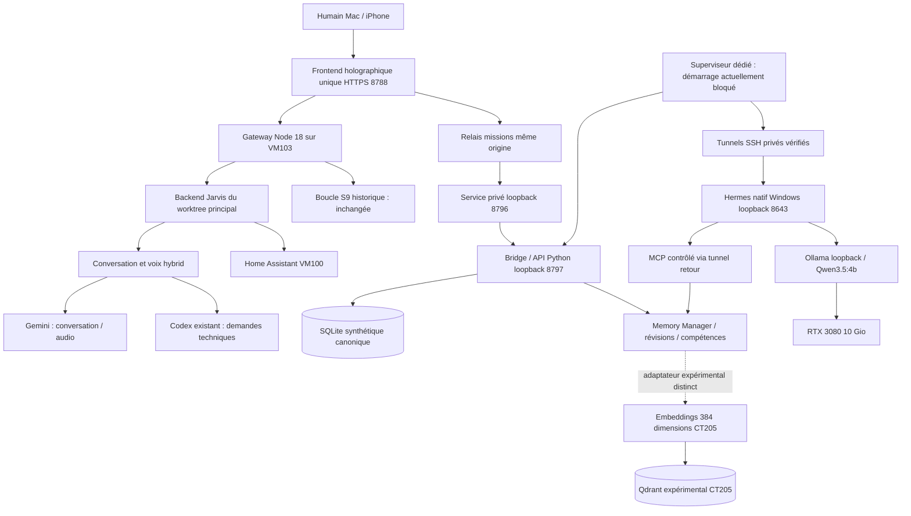

# Architecture conservée

Le chemin Qdrant a été validé réellement en laboratoire. **Le service à la demande installé n'a pas un nouveau transport CT205 activé** : il utilise par défaut SQLite/FTS. Le diagramme ne constitue pas une déclaration d'activation de toutes ses liaisons.

## Conversation, frontend et gateway

Le frontend réellement servi est `/home/user/gateway/public/jarvis/`, distinct du `public/` du dépôt de développement. Il contient texte, hologramme, mémoire, microphone et composants vocaux. Le panneau Hermes est intégré, pas une deuxième interface.

`/home/user/gateway/server.js` importe directement `/home/user/workspace/jarvis/backend.mjs`. Ce backend compose mémoire vocale, archives, connaissances, capacités, voix et réponses. Le mode observé est `hybrid` : ne pas le remplacer par Gemini Live natif pour brancher Hermes. Les mécanismes d'interruption, PCM, microphone et streaming restent ceux de Jarvis.

Le Codex historique et les intégrations HA conservent leurs capacités existantes. Leur séparation effective des privilèges reste une dette de sécurité ; Hermes ne reçoit aucun de leurs accès shell/réseau. Les adaptateurs sécurisés et le broker préparés ne sont pas tous montés dans cette gateway.

## Missions et mémoire

Le relais même origine transmet les requêtes vers le service privé. Le navigateur n'obtient aucun secret bridge ni accès direct aux ports privés. Les sessions humaines Hermes et ACL privées restent en place, **sans SSO global actif**.

Le bridge admet, suit et annule des missions persistantes. `mm_missions` est le registre existant ; `p2_outbox` suit le dispatch. `p6q_jobs` et `p6q_keys` ajoutent réservations/idempotence, pas une seconde mémoire. Le superviseur sollicite cette API sous identité dédiée. Une mission incertaine reste visible et en quarantaine, sans rejeu.

Memory Manager distingue faits candidats, révisions, provenance, corrections, épisodes, projets et compétences. SQLite est canonique ; les résultats vectoriels sont revalidés dans SQLite, y compris droits et statut actuel. Une correction remplace la version active en conservant l'historique. `inferred` ne devient jamais confirmé parce qu'un modèle le répète.

Il existe aussi les stockages historiques de Jarvis (`brain.sqlite`, mémoire vocale, archives) : ne pas les confondre avec la base synthétique du pilote. Aucun import personnel massif n'est réalisé.

## Windows et calcul local

Hermes officiel épinglé : `4959268e312a21a361f248e49030d5f5df3984d5`. Installation native `C:\JarvisHermesLab`, compte standard `hermeslab`, runtime isolé, outils MCP limités. Sa mémoire factuelle native n'est pas une seconde source de vérité ; ses sessions servent de traces temporaires d'exécution.

Ollama et Qwen3.5:4b utilisent la RTX 3080 du PC Windows 11 `192.0.2.96`. Contexte 64 000 réellement observé historiquement. Les tunnels sont temporaires, SSH vérifie les clés hôtes ; les ports techniques 8643, 11435/11436 et le chemin MCP restent privés. Les valeurs exactes dépendent des lanceurs : ne pas ouvrir de port ou inventer un tunnel pour résoudre un refus.

Le modèle propose et rapporte ; les services imposent droits, budgets, validation et publication. Les compétences sont candidates versionnées, évaluées indépendamment, sans publication automatique ni réentraînement des poids.

## Infrastructure

Proxmox `192.0.2.200` : VM103 Codex-cli/gateway, VM100 Home Assistant, VM201 Tailscale ; CT205 jarvis-memory / Qdrant / embeddings. VM102 jarvis-lab reste arrêtée sur disque. Aucun besoin de réserver sa RAM pour Hermes, désormais sur Windows.

Le contrôle S9 tourne encore depuis la gateway. Son nom ne prouve pas qu'il s'agit du S19 Hydro : aucune intervention sur équipements n'est incluse. Les sécurités physiques restent indépendantes des modèles.
